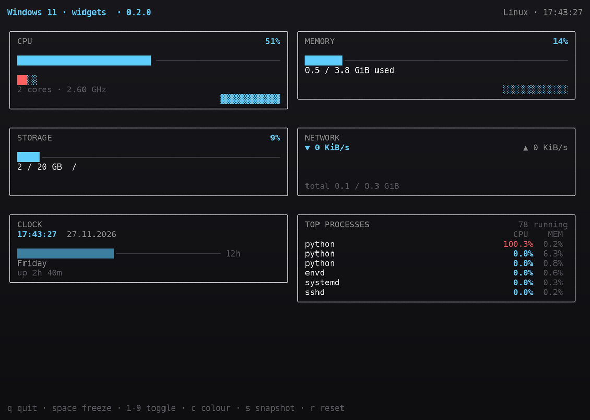
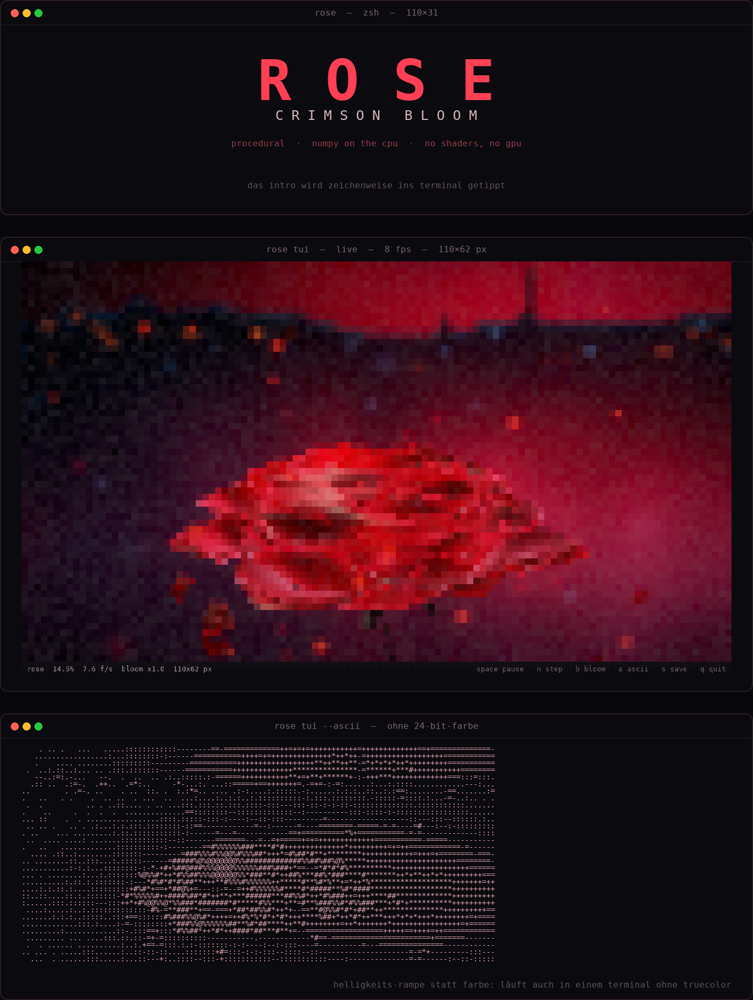

# 🌹 rose — crimson bloom

Eine komplett prozedurale Rosen-Animation im *Tokyo-Ghoul*-Look: **nur die
Rose** — dunkle, samtige Petalen, glühende Adern, fallende Blütenblätter,
Glut-Partikel, Bloom, God-Rays und Film-Grain vor einem tiefroten Nichts.
Keine Stadt, kein Horizont, keine Ablenkung; die Blüte ist das ganze Bild.

Wer die Ruinen-Skyline von früher doch haben will: überall `--city` anhängen.

Alles wird **auf der CPU mit numpy gerendert** — kein GPU, kein OpenGL, keine
Spiel-Engine, keine Shader. Der komplette Renderer (Rasterizer, Shading, Bloom,
Grading) ist in diesem Repo selbst geschrieben und läuft auf einem Laptop.


## Windows 11 Widgets — im Terminal

Dieselbe Idee, andere Richtung: ein **Widget-Board für den Desktop, das in
Windows Terminal läuft** — keine Webseite, kein Fenster, kein Server. Karten im
Windows-11-Look (runde Ecken, Akzentfarbe aus Windows, Segoe-Anmutung) mit
Live-CPU, RAM, Datenträgern, Netzwerk, Top-Prozessen, Uhr und Akku.



```bash
python -m pip install psutil          # einziges Extra
python -m winwidgets                  # Board starten
python -m winwidgets cpu clock        # nur zwei Karten
python -m winwidgets --list           # was es gibt
```

Tasten: `q` beenden · `space` einfrieren · `1`–`7` Karte an/aus · `c` Farbmodus
(truecolor → 256 → mono) · `s` Bild als Text speichern · `r` Verlauf löschen.

Auf Windows reicht Doppelklick auf **`widgets.bat`**; die ausführliche
Anleitung steht in **`START-WIDGETS.txt`**. Fertige Pakete:
`download/winwidgets-v0.2.0.zip` und `download/winwidgets-v0.2.0.pyz`.

Warum Terminal und nicht HTML: ein Board, das man den ganzen Tag offen hat,
sollte ein Tab sein und kein Browserfenster — und 25 kB Python statt 300 kB
JavaScript. Die Karten zeichnen sich mit Box-Zeichen aus der Standardschrift
(`│ ─ ╭ ╮ ─ █ ░`), also **kein Nerd Font nötig**; Farben laufen über 24-Bit-ANSI
und fallen automatisch auf 256 Farben oder reines ASCII zurück.

## Herunterladen statt einrichten

Fertige Pakete liegen in `download/` (neu bauen mit
`.venv/bin/python tools/package.py`):

| Datei | Was es ist |
| --- | --- |
| `rose-standalone-v0.1.0.pyz` | **eine** Datei, das Video ist eingebettet: `python rose-standalone-v0.1.0.pyz` startet den Film, `... save rose.mp4 rose.mp4` schreibt den Clip heraus. Braucht nur numpy + Pillow. |
| `rose-v0.1.0.zip` | das ganze Projekt (Code, Tests, Doku, Video) mit `START-HIER.txt` |
| `rose.mp4` | nur der Loop, 1280×720, 10 s (14 MB) |

`python rose-standalone-v0.1.0.pyz show` sagt, was drin ist;
`python rose-standalone-v0.1.0.pyz save poster.png poster.png` holt das Standbild
heraus. Das Gleiche geht aus dem Quellcode mit `python -m rose show` / `save`.

## Schnellstart

```bash
python3 -m venv .venv
.venv/bin/pip install -r requirements.txt

# DER FILM IM TERMINAL — kein Browser, kein Player, nur die Konsole
.venv/bin/python -m rose

# Live-Vorschau im Browser (rendert in Python, streamt JPEGs)
.venv/bin/python -m rose serve --port 8000

# ein Standbild in 4K
.venv/bin/python -m rose --width 3840 --height 2160 still poster.png

# ein Video (mp4, 24 fps)
.venv/bin/python -m rose --width 1280 --height 720 video rose.mp4 --seconds 12 --fps 24

# PNG-Sequenz
.venv/bin/python -m rose frames frames/ --seconds 6 --fps 24
```

Beim Start von `serve` öffnet die Vorschau automatisch ein Fenster im Browser
(der Server bindet an `0.0.0.0`, damit die Sandbox-Vorschau funktioniert).
Tasten: `Space` = Pause, Buttons für Replay und "save frame". Mit `--terminal`
zeigt der Server stattdessen die Halbblock-Ansicht des Terminals (siehe unten).

## Die Rose im Terminal



`python -m rose` (oder explizit `python -m rose tui`) startet den Film direkt in
der Konsole — kein Fenster, keine Datei, kein externer Player. Dafür gibt es
zwei Tricks:

1. **Halbe Blöcke.** Jede Zeichenzelle malt zwei Pixel: das obere Halbzeichen
   `▀` in der Farbe des oberen Pixels, die Zellhintergrundfarbe ist das untere.
   Aus 110×31 Zeichen werden so 110×62 Pixel.
2. **24-bit-Farbe pro Zelle.** Jede Zelle bekommt ihre eigene Vorder- und
   Hintergrundfarbe (`ESC[38;2;…` / `ESC[48;2;…`) — das Bild ist ein echtes
   Bild, nur grob. Ohne truecolor-Terminal schaltet die App automatisch auf eine
   Helligkeitsrampe (` .:-=+*#%@`) um, mit Auto-Level, damit die dunkle Rose
   nicht zu grauem Matsch wird.

Gerendert wird *derselbe* Renderer wie für Poster und Video, nur auf einer
kleinen Leinwand (ca. 165×93 px, 1,5× supersampled): Petalen, Bloom, Glut und
fallende Blätter sind identisch. Weil nur die Rose im Bild ist, ist der
Ausschnitt dafür gebaut — die Kamera gleitet dicht an der Blüte entlang statt
um sie herumzukreisen, und Stängel und Blatt bleiben außerhalb des Bildes
(sonst gucken sie als dunkle Splitter unten heraus). Ein Frame braucht
dort ~0,2 s, deshalb läuft der Player mit 8 fps und passt sich an die
Terminalgröße an; jede Frame-Zeit ist die echte Uhrzeit, der Film läuft also in
Echtzeit weiter, auch wenn das Terminal mal kurz hängt.

| Taste | Wirkung |
| --- | --- |
| `Space` | Pause / weiter |
| `n` | ein Frame weiter (während Pause) |
| `b` | Bloom-Stärke durchschalten (×0,6 / ×1,0 / ×1,4) |
| `a` | Farbe ↔ ASCII-Rampe |
| `f` | 6 / 10 / 16 fps |
| `s` | aktuellen Frame als PNG nach `assets/` speichern |
| `h` | Statuszeile ein-/ausblenden |
| `q`, `Esc` | beenden |

Nützliche Flags: `--seconds 20` (nach 20 s aufhören), `--cols 80 --rows 24`
(Größe erzwingen), `--no-intro`, `--ascii`, `--no-color`, `--fps 16`,
`--city` (Skyline hinter der Rose wieder einschalten).
Wird die Ausgabe in eine Datei oder Pipe umgeleitet, malt die App ein
Standbild als reinen Text (keine Steuerzeichen); mit `--dump out/` bekommt man
einen ganzen Clip als Textframes.

Kurz gesagt: `rose` allein ist der Terminal-Film, `rose serve` dieselbe Rose im
Browser, `rose video`/`still` für eine Datei.

Und wenn man den Terminal-Look im Browser zeigen will (z. B. in einer
Präsentation oder auf einem Rechner ohne echtes Terminal): der Server kann die
Halbblock-Ansicht ausliefern, Zelle für Zelle, ohne ANSI-Codes — dieselbe
Optik, nur als Canvas:

```bash
.venv/bin/python -m rose serve --terminal --cols 110 --rows 31 --port 8000
```

`/` zeigt dann den Terminal-Player als Webseite (`Space` pausiert), `/cells`
liefert die Zellfarben als Binärdaten (6 Byte pro Zelle: obere und untere
Hälfte als RGB).

## Was da eigentlich passiert

| Modul | Aufgabe |
| --- | --- |
| `rose/scene.py` | Die Rose: 7 Whorls à 3–8 Petalen, jede als gebogenes „Schwert“ mit Kelch-Querschnitt, Sepalen, Stängel, Blatt. Zwei Licht-Rigs (Bühne/Solo), Skyline-Geometrie für `--city`, Staub. |
| `rose/raster.py` | Kachelbasierter Software-Rasterizer (10×10-Tiles, vektorisierte Baryzentrik, korrekter Z-Buffer) + Pixel-Shader (Fresnel-Rim, Seiden-Spec, Transmission, AO). |
| `rose/shading.py` | Prozedurale Petalen-Textur (Adern, Seide, dunkler Schlund, glühende Spitzen) und eingebackene farbige Lichter. |
| `rose/sky.py` | Gebackene Himmelskuppel: Gradient, Wolken, Mondsichel, Skyline mit Fenstern, rote Glut, Rauch unter dem Horizont. |
| `rose/effects.py` | Gauß-Splats (Bokeh, Glut, Staub), Bloom-Pyramide, God-Rays, chromatische Aberration, Vignette, Grain, ACES-Tonemapping. |
| `rose/renderer.py` | Komposition pro Frame: Kamera, Blütenöffnen („Atmen“), fallende Blütenblätter mit Motion-Halo, Grading. Enthält den Solo-Modus (`solo()`): roter Studio-Hintergrund statt Himmelskuppel, dichterer Ausschnitt, eigenes Licht. |
| `rose/server.py` | Mini-HTTP-Server + HTML/Canvas-Player mit Frame-Prefetch. |
| `rose/terminal.py` | Der „Terminal-Künstler“: Frame → Halbblock-Zellen, truecolor-/256-Farben-/ASCII-Ausgabe, Intro-Titel. |
| `rose/assets.py` | Die mitgelieferten Dateien finden (Checkout, Wheel oder `.pyz`) und herausschreiben: `show`, `save`. |
| `rose/tui.py` | Der Terminal-Player: Echtzeit-Loop, Tastatur (Pause, Bloom, ASCII, Speichern), Intro, Auto-Resize. |

### Die Blüte

Jede Petale ist ein Punktgitter: ein *Mittelnerv*, der aus der Blüte spiralt und
sich mit dem Radius nach außen neigt, ein runder Querschnitt (echter Kreisbogen,
kein Polynom) und Kelch-/Kräusel-Terme. Die inneren Whorls sind fast geschlossen,
die äußeren öffnen sich zu einer Schale — diese Tabelle (`PETAL_STYLES`) ist die
Form der Blume und lässt sich frei verändern.

### Das Licht

Fünf Lichter, die die *Tokyo-Ghoul*-Farbdramaturgie erzeugen:

1. warmes Key-Licht (Seidenglanz),
2. schwaches rotes Fill,
3. kaltes teal Back-Light (Kontrast zur roten Blüte),
4. tiefes rotes Rim-Light (die Signatur),
5. rote Unterglut („Glut von unten“).

### Nur die Rose

Ohne Skyline fällt der Himmel als Lichtquelle weg, deshalb hat der Solo-Modus
ein eigenes Rig: das Key-Licht sitzt frontaler (sonst liegt die Vorderseite der
Blüte im Dunkeln), dafür sind Rim- und Gegenlicht härter — das ist der
*Tokyo-Ghoul*-Kontrast. Der Hintergrund ist kein Bild, sondern eine Formel: ein
tiefrotes Leuchten um die Blüte, ein wenig Rauch, ein dunkler Rand zum
Bildrand hin. Dazu ein größerer, weicherer Halo und mehr Bloom, weil nichts
mehr da ist, was das Auge ablenkt.

### Der Look

ACES-Tonemapping → Splittone-Grading (kalte Schatten, warme Lichter) → Bloom →
God-Rays → chromatische Aberration in den Ecken → Vignette → Filmkorn →
Dithering gegen Banding in den Schwarztönen.

## Performance

| Auflösung | pro Frame (2 Kerne, CPU) |
| --- | --- |
| 165×93 (Terminal, 110×31 Zeichen) | ~0,2 s |
| 640×360 | ~0,8 s |
| 854×480 | ~1,1 s |
| 1280×720 | ~2,5 s |

Für die kleine Terminal-Leinwand gibt es drei Abkürzungen, die das Bild nicht
verändern: sub-pixelkleine Dreiecke werden verworfen, das Petalengitter ist
gröber (13×15 statt 17×19) und die Blüte wird etwas weiter weg kadriert, damit
sie ganz ins Bild passt.

Die Vorschau läuft deshalb asynchron: der Browser fragt Frames an, der Server
rendert einen nach dem anderen und cached die 240 Phasen des Loops. Nach einem
Durchlauf läuft die Animation flüssig aus dem Cache.

## Tests

```bash
.venv/bin/python -m pytest -q
```

## Struktur

```
rose/              die App (Renderer, Effekte, Terminal-Player, Server, CLI)
tests/             Tests für Geometrie, Rasterizer, Pipeline und Terminal-Ausgabe
assets/poster.png  Beispiel-Standbild (1600x900)
assets/rose.mp4    der 10-Sekunden-Loop (nur die Rose, 1280x720)
assets/rose_web.mp4 die kleine Web-Version (6 MB)
docs/terminal.png  Screenshot des Terminal-Players (tools/terminal_shot.py)
```

Viel Spaß — und ja, die Rose „atmet“ wirklich: sie öffnet und schließt sich
leicht, während die Kamera langsam um sie herumfährt.
